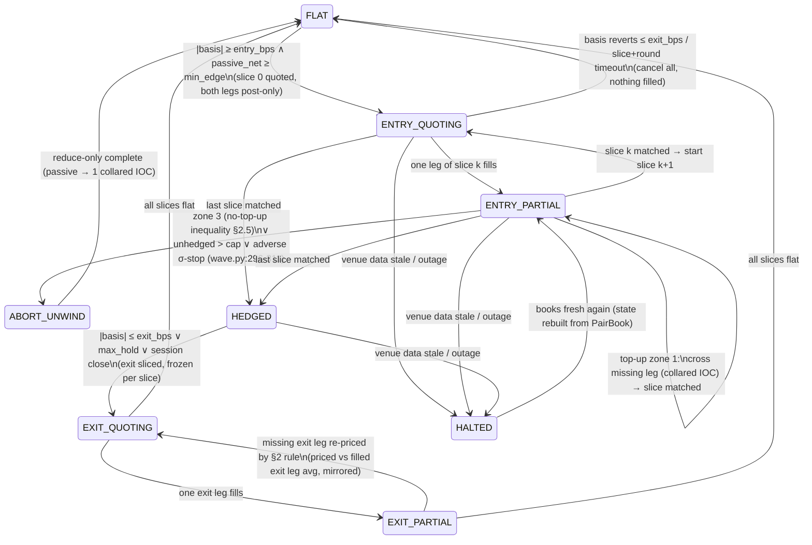

# Two-leg balance: sliced entry/exit, top-up pricing, dynamic rebalance — design

Date: 2026-11-09 · Scope: `arbtwin/wave.py`, `arbtwin/wavetrader.py`, `arbtwin/engine.py`,
`arbtwin/exitqueue.py` (wave strategy, `config/risk.yaml: strategy: wave`).
Companion: `diff-proposal.md` (function-level change list), `sources.jsonl` (citations).

Conventions used below:

* Legs **A = OKX** (USDT perp, 2/5 bps maker/taker, no speed bump), **B = Lighter**
  (USDC perp, 0/0 bps Standard, 300 ms taker speed bump, no bump on post-only) —
  README §1.2.
* All Lighter prices are **normalised**: `p̃_B = p_B / unit_ratio` (`arbtwin/models.py:9-13`,
  `spread.py:5`). Quantities `q` are normalised base units (one OKX unit ↔ `unit_ratio`
  Lighter units), so a matched pair has `q_A = q_B = q`.
* Sign convention (`spread.py:81-89`): `basis_bps = (p̃_B − p_A)/p_A × 1e4`;
  `basis ≥ 0` → B rich → **long A / short B**; `basis < 0` → **long B / short A**.
* `L` = the long leg, `S` = the short leg, whichever venue they sit on.
* `β = b*/1e4`, where `b*` is the **target combined pair basis** (entry condition
  inclusive of fees/slippage), defined per order-type tier in §2.3.
* [INFERENCE] marks my own derivations; all repo claims carry file:line citations.

---

## 0. Why the current machine cannot do what the operator asked

Current behaviour (all `wave.py:decide`):

1. One shot per round: `_entry_orders` (wave.py:193) places the **full** target qty on
   both legs at their own touch (`passive_px`, wave.py:174).
2. One leg fills → `ENTRY_PARTIAL` (wave.py:289): the *unfilled* leg keeps re-pegging
   **at the live touch** (`_requote`, wave.py:206) — i.e. the top-up is priced from the
   two venues' simultaneous market prices, exactly what the operator forbade.
3. Remedies are binary: complete at touch, or `ABORT_UNWIND` (wave.py:319-330) when
   |basis| reverts, the naked leg exceeds 150 USD / the σ-scaled adverse stop
   (wave.py:296-311), or `entry_deadline_s` hits.
4. Exits are one-shot at a **frozen** trigger price (wave.py:355-417,
   `.field-guide/repo-invariants.md` "exit prices are frozen"), re-pegged wholesale,
   one IOC escalation.
5. Measured consequence (`docs/MECHANICS-ROUNDS-2026-11-08.md`): 4/5 rounds never paired;
   the single paired round lost 30.66 bps at exit escalation. `p_fail` measured ≈ 0.8,
   not the 0.13–0.2 assumed. Full-size passive quotes on both touches simply do not
   fill together — the operator's observation is the data.

Also load-bearing for this design:

* `on_fill` (wave.py:426-428) sets `leg.filled_px = px` — the **last** fill price, not a
  VWAP. Harmless while a leg fills once; wrong the moment legs fill in slices. Must
  become notional accumulation (`C = Σ qᵢ·pᵢ`, `P̄ = C/Q`).
* `round_pnl_bps` (wave.py:451-464) compares raw Lighter px against OKX px **without**
  `/unit_ratio`; fine at ratio ≈ 1.000, biased otherwise. Fix alongside (§ diff-proposal).
* Live fills arrive as position deltas (`engine._reconcile_positions` →
  `reconcile.PositionLedger.reconcile`, reconcile.py:93); the design must not assume
  per-order fill pushes exist.

---

## 1. State machine extension: slices + per-leg states

### 1.1 Structures

```python
class LegState(Enum):          # per leg, per slice
    IDLE = "idle"              # slice not started on this leg
    QUOTING = "quoting"        # ≥1 post-only order resting
    PARTIAL = "partial"        # some of the slice qty filled, order still live
    FILLED = "filled"          # slice qty complete on this leg
    REJECTED = "rejected"      # venue rejected (post-only cross, min size, …)
    UNWINDING = "unwinding"    # reduce-only working against this leg
    HALTED = "halted"          # venue data stale / outage — no orders allowed

@dataclass
class PairBook:                # per round, replaces "filled_px = last px"
    Q_L: float; C_L: float     # long leg: matched qty, Σ q·p̃ (normalised)
    Q_S: float; C_S: float     # short leg
    def avg_L(self): return self.C_L / self.Q_L if self.Q_L else 0.0
    def avg_S(self): return self.C_S / self.Q_S if self.Q_S else 0.0
    def matched_q(self): return min(self.Q_L, self.Q_S)
    def delta(self):     return self.Q_L - self.Q_S      # >0: long leg overfilled
    def unhedged_usd(self, px): return abs(self.delta()) * px
    def combined_basis_bps(self):
        # denominator = long leg avg, matching wave.round_pnl_bps convention
        if not self.Q_L or not self.Q_S: return None
        return (self.avg_S() - self.avg_L()) / self.avg_L() * 1e4
```

`Round` keeps its 7 states and gains: `slices: list[Slice]`, `slice_index: int`,
`pair: PairBook`, `episode: RebalanceEpisode | None` (§5), `venue_ok: dict[str,bool]`.

```python
@dataclass
class Slice:
    index: int
    qty_norm: float            # matched target for this slice (normalised units)
    legs: dict[str, Leg]       # venue -> Leg (existing dataclass + LegState + slice qty)
    started_ts: float = 0.0
    deadline_s: float          # slice-level entry deadline (≪ round deadline)
```

### 1.2 Round states (enum unchanged; semantics extended)



`HALTED` is the only new enum value. It is an overlay, not a strategy: while any venue
is stale (`book_age > max_book_age_s`, risk.yaml; `ws_age_s > 30`, README §7.1) the round
cancels what it can on the **healthy** venue, sends nothing anywhere, and only risk stops
(§6) remain armed. Rationale: the CBB incident post-mortem in `docs/REVIEW-2026-11-08.md`
§11.3 — acting on stale position/market reads is how accounts get doubled.

### 1.3 Transition table (trigger × state → action)

| Trigger | ENTRY_QUOTING | ENTRY_PARTIAL | HEDGED | EXIT_* | ABORT_UNWIND |
|---|---|---|---|---|---|
| **Fill (partial, slice leg)** | → ENTRY_PARTIAL; `PairBook += (q, p̃)`; start slice clock | update avg; recompute `p_limit` (§2); stay | n/a | update exit PairBook; re-price missing exit leg vs **filled exit leg avg** (same math, §2.6) | leg → UNWINDING→FILLED |
| **Fill (slice complete both legs)** | next slice or → HEDGED | next slice or → HEDGED | — | next exit slice or → FLAT | → FLAT |
| **Cancel ack** | leg QUOTING→IDLE, re-quote next poll | missing leg re-quotes at `min(passive_px, p_limit)` | — | re-quote frozen/ladder px | re-quote reduce-only |
| **Reject (post-only would cross)** | re-price once at `passive_px`; 2nd reject in 60 s → hold + alert (`reject_rate`, README §7.1) | same; if reject because `p_limit` is marketable → that is zone 1: cross deliberately (§3) | — | same | same |
| **Reject (min size/lot)** | reslice: merge slice into next (§4.4); never shrink below `min_quote` (Lighter $10, `engine._target_notional`) | same | — | same | same |
| **Slice timeout (`slice.deadline_s`)** | cancel, → FLAT if nothing filled anywhere | zone check: complete-if-cheaper vs `_abort` (existing passive unwind, wave.py:217) | — | escalate per `exitqueue` ladder | existing `exit_deadline_s` → one collared IOC (wave.py:340-352) |
| **Round timeout (`entry_deadline_s`)** | → FLAT | → ABORT_UNWIND (existing) | — | IOC escalation (existing) | IOC (existing) |
| **Disconnect / stale book (either venue)** | → HALTED: cancel-all healthy venue, persist state | → HALTED; naked leg keeps σ-scaled adverse stop computed from **last fresh** marks; on reconnect, reconcile positions before any order | → HALTED (exits pause; force-flat clock keeps running only if session close is near) | → HALTED | → HALTED; unwind resumes on reconnect |
| **Price jump** (`|Δbasis| > jump_bps` in one poll, or leg move > 3σ√dt) | cancel both legs, re-evaluate FLAT gate (jumps are when post-only gets run over; queue-reactive evidence: fills cluster on through-prices, arXiv:1312.0563) | cancel missing-leg quote; recompute `p_limit`; **never** chase in the same poll; if jump killed the edge → zone 3 → abort | treat as exit-trigger candidate only if through `exit_bps` with hysteresis | re-freeze exit px at post-jump level only if still ≥ exit target; else hold ladder | pause passive unwind 1 poll, then continue |
| **Position-delta without slice** (reconcile.py:93 emits FillEvent that matches no live slice) | — | → HALTED + critical alert (someone/something else moved the account) | same | same | same |

Per-leg states are pure bookkeeping on top of this table; `LegState.HALTED` blocks every
order type including re-pegs; `REJECTED` auto-clears on the next successful placement.

---

## 2. Top-up pricing math (the operator's rule, formalised)

> Requirement: a top-up is priced from **the missing leg's executable price versus the
> already-filled leg's average entry price**, so the *combined* basis still satisfies the
> entry condition — never from the two venues' simultaneous market prices, and never as a
> marginal tick.

### 2.1 Combined basis on total matched quantity and total notional

With `PairBook` (Q, C per leg), the combined entry basis of everything matched so far:

$$b_{comb} = \frac{\bar P_S - \bar P_L}{\bar P_L}\times 10^4,\qquad
\bar P_L = \frac{C_L}{Q_L},\quad \bar P_S = \frac{C_S}{Q_S}$$

(denominator = long leg, matching `wave.round_pnl_bps`, wave.py:453-457). The entry
condition `b_comb ≥ b*` is equivalent to

$$\boxed{\;\bar P_S \;\ge\; \bar P_L\,(1+\beta)\;}\qquad(\beta = b^*/10^4)$$

### 2.2 Limit price for the missing quantity — both directions, incremental form

Let the missing leg need `Δ > 0` normalised units to match the filled side
(`Δ = |Q_S − Q_L|`; the overfilled side defines the target `Q' = Q_filled_side`).

**Case L — missing leg is the LONG leg (must buy Δ at price p).**
After the buy: `Q_L' = Q_L + Δ`, `C_L' = C_L + Δ·p`. Feasibility `C_L'/Q_L' ≤ P̄_S/(1+β)`:

$$p \le p^{buy}_{max} = \frac{Q_L'\cdot \dfrac{\bar P_S}{1+\beta} - C_L}{\Delta}
= \frac{Q_L'\cdot \dfrac{C_S}{Q_S(1+\beta)} - C_L}{\Delta}$$

**Case S — missing leg is the SHORT leg (must sell Δ at price p).**
After the sell: `Q_S' = Q_S + Δ`, `C_S' = C_S + Δ·p`. Feasibility `C_S'/Q_S' ≥ P̄_L(1+β)`:

$$p \ge p^{sell}_{min} = \frac{Q_S'\cdot \bar P_L\,(1+\beta) - C_S}{\Delta}$$

Both are **weighted-average-preserving**: they are exactly the price at which the new
combined position (total matched qty, total notional) sits on the `b*` boundary.
Special case `Q_missing = 0` (nothing filled yet on the missing leg — the common
`ENTRY_PARTIAL` case today):

$$p^{buy}_{max} = \frac{\bar P_S}{1+\beta}\qquad\text{resp.}\qquad p^{sell}_{min} = \bar P_L\,(1+\beta)$$

i.e. *price purely off the filled leg's average entry* — the operator's rule verbatim.
Direction mapping: `long_okx_short_lighter` → the missing leg buys on OKX (Case L,
venue A) or sells on Lighter (Case S, venue B); `long_lighter_short_okx` → mirror.
Convert back to raw Lighter ticks with `p_B = p̃_B × unit_ratio` before ordering.

### 2.3 What `b*` is, per order-type tier

`b*` is not one number; the marginal top-up carries different cost depending on how it
executes. With repo cost口径 (`spread.py:compute_row`, README §5.2):

| Tier | Definition | Default value [INFERENCE, calibrate per symbol] |
|---|---|---|
| `b*_pass` | combined basis required to **rest** a top-up (maker both sides): `exit_bps + round_trip_maker_fee + ½·(spread_A + spread_B) + funding` ≈ `4.5 + 4 + spread_cost + funding` (spread_cost already computed as `spread_cost_bps`, spread.py:104-107) | ≈ 10 bps on a 2-bps-spread name |
| `b*_cross(X)` | `b*_pass + [taker−maker]_X + latency_cost_bps(σ_1h, bump_X)`; `latency_cost_bps = σ_1h·√(ms/3.6e6)` (README §5.2, `mechanics.py`) | OKX: `+3 bps`; Lighter: `+0 bps + σ·√(300/3.6e6)` (= +2.2 bps at σ₁ₕ=244 SOXL-like, +0.3 bps at σ₁ₕ=30) |
| `b*_abort` | all-in round-trip cost floor below which completing is worse than unwinding: `round_trip_fee + one passive half-spread on the filled leg` | ≈ 6-7 bps |

Note the asymmetry the venues hand us: Lighter taker is **free but slow** (300 ms bump),
OKX taker is **fast but 5 bps**. `b*_cross` decides per symbol which venue may cross
(§3) — on quiet names Lighter-cross dominates; on σ₁ₕ > ~350 bps names the bump drift
outweighs OKX's 3 bps incremental fee.

### 2.4 Three-zone top-up policy (replaces "re-peg at touch")

Let `p_exec` = best **executable** price of the missing leg right now (crossing price:
`marketable_px`, wave.py:184), and `p_touch` = our passive side (`passive_px`, wave.py:174).
All comparisons at the tier-appropriate `β`:

```
zone 1  CROSS:    b_comb(p_exec) ≥ b*_cross(venue)          → IOC, limit-priced at p_limit
zone 2  REST:     p_limit is within ladder of the touch     → post-only at
                  (|p_touch − p_limit|/p_touch ≤ 5 bps,          min(p_touch, p_limit) rounded
                   reusing exitqueue ladder cap semantics)      to tick, in the safe direction
zone 3  NO TOP-UP: otherwise                                 → §2.5 decision
```

where `p_limit = p^buy_max` (Case L) or `p^sell_min` (Case S), and `b_comb(p)` evaluates
§2.1 with the candidate fill folded in. Zone 2 is the important behavioural change: the
resting top-up price is **`p_limit`, not the touch** — the quote may sit deeper than the
market, because the filled leg's average (not the live tape) defines what we can pay.
Deep resting is bounded by the 5 bps ladder cap so we never leave a stale far-away quote
that only fills when the basis is collapsing (adverse selection on deep quotes is the
documented toxic-fill channel; order-flow toxicity: Easley et al. VPIN, sources.jsonl).

### 2.5 The "do not top up" inequality, and abort-vs-complete

Do not top up (zone 3) when the missing leg cannot be obtained — passively within the
ladder, or by crossing — without breaking the combined entry condition:

$$\text{no top-up} \iff b_{comb}(p_{touch}) < b^*_{pass}
\;\;\wedge\;\; \frac{|p_{touch}-p_{limit}|}{p_{touch}} > 5\,bps
\;\;\wedge\;\; b_{comb}(p_{exec}) < b^*_{cross}$$

Then choose the cheaper of two endings [INFERENCE, decision rule]:

* **Complete anyway** if `b_comb(p_exec) ≥ b*_abort` — the pair still clears all-in cost;
  take it as a crossing top-up at `p_limit` priced with `β_abort` (lower bar, still a
  limit — never pay through `p_limit`).
* **Unwind** if even that fails: existing `ABORT_UNWIND` path (passive reduce-only of the
  filled leg, wave.py:332-353, one collared IOC after `exit_deadline_s`). Its cost is
  ≈ one half-spread + maker fee on the filled leg, which is *less* than completing at a
  combined basis below `b*_abort`.

This is the incremental position-vs-marginal-tick distinction made operational: the
marginal tick may look dead while the combined position is still fine (worked example
Case 2 below), and vice versa.

### 2.6 Exits use the same math, mirrored

Today exit legs re-peg at the **frozen entry-trigger price** (wave.py:398-404; invariant
in `.field-guide/repo-invariants.md`). With sliced exits, once one exit leg has filled
q_x at average `p̃_x`, the missing exit leg's limit is the mirror of §2.2 with the
**exit** target `b_exit ≤ exit_bps`: we need `b_comb_exit = (P̄_S,exit − P̄_L,exit)/P̄_L,exit ×1e4 ≤ exit_bps`,
solved the same way for the missing side (a sell floor becomes a sell cap, etc.). The
frozen price becomes the *first* slice's price; later slices price off realised exit
averages, which is what stops the VVV failure mode (60 min no fill → 30.66 bps IOC,
MECHANICS-ROUNDS §5): the exit ladder keeps the pair's combined exit basis inside target
instead of waiting for one arbitrary frozen number on both venues.

### 2.7 Worked numeric example (illustrative prices — not market data)

Symbol COIN-like, `unit_ratio r = 0.9984` (measured, README §6.2), tick_A = 0.01,
`b*_pass = 10 bps`, `b*_cross(OKX) = 13 bps`. Direction: B rich → **long A / short B**.
Lighter short leg filled first (the common case): `Q_S = 10` units, avg raw px 300.45 →
normalised `P̄_S = 300.45/0.9984 = 300.9315`.

**Case 1 — first-fill top-up (Q_L = 0).**
`p^buy_max = P̄_S/(1+β) = 300.9315/1.001 = 300.6309` (normalised) → raw OKX px is the
same (A is the numéraire): **300.63** after tick floor.
OKX ask = 300.70: `b_comb(300.70) = (300.9315−300.70)/300.70 ×1e4 = 7.7 bps < 10` →
no cross, and 300.70−300.63 = 2.3 bps above `p_limit` → **zone 2**: rest post-only buy
at 300.63 (below the bid if bid ≥ 300.64 — a deep but bounded quote). If the ask trades
down to ≤ 300.63 we fill at a combined basis ≥ 10 bps by construction. Only if ask
≤ `P̄_S/1.0013 = 300.5408` does zone 1 fire (cross at 13 bps combined, paying OKX taker).

**Case 2 — incremental top-up (the marginal-tick trap).**
Earlier slices left `Q_L = 4 @ p̄_L = 299.90` (C_L = 1199.60); missing `Δ = 6`, `Q_L' = 10`.

```
p^buy_max = [10 × 300.9315/1.001 − 1199.60] / 6
          = [3006.3087 − 1199.60] / 6 = 1806.7087 / 6 = 301.1181  → tick floor 301.11
```

Live tape: OKX ask 300.70, Lighter bid (raw) 300.40 → normalised 300.8814.
*Marginal* basis = (300.8814 − 300.70)/300.70 ×1e4 = **6.0 bps < 10** → a marginal-tick
rule (today's `_requote`-at-touch logic, and any "both venues' simultaneous prices"
rule) **refuses** the top-up.
*Combined* basis if we buy the 6 at 300.70: `P̄_L' = (1199.60 + 6×300.70)/10 = 300.38`;
`b_comb = (300.9315 − 300.38)/300.38 ×1e4 = 18.4 bps ≥ 13 = b*_cross(OKX)` → **zone 1:
cross the OKX IOC now**, collared at 301.11. The cheap early fills on the long leg are
exactly what the combined accounting must monetise; the marginal view throws them away.

**Case 3 — no top-up.**
Same Case-2 position, but the tape moved up: OKX bid/ask = 301.40/301.45.
Resting at the touch would give `P̄_L' = (1199.60+6×301.40)/10 = 300.80` →
`b_comb = (300.9315−300.80)/300.80 ×1e4 = 4.4 bps < b*_pass` → zone-2-at-touch fails.
`p_limit = 301.11` sits 9.4 bps **below** the bid — outside the 5 bps ladder cap → deep
rest fails too. Crossing at the ask: `P̄_L' = 300.83` → `b_comb = 3.4 bps < b*_abort ≈ 6.5`
→ zone 1 and the abort-tier completion both fail. All three §2.5 conditions hold →
**do not top up**; unwind the filled quantities passively (existing ABORT path,
wave.py:332-353). Note the marginal view alone (4.4 bps) cannot distinguish this from
Case 2 — only the combined accounting plus the ladder/abort tiers can. [INFERENCE]

**Case 4 — reverse direction (long B / short A), raw-price conversion.**
OKX short filled `Q_S = 10 @ 300.45` (A is short leg now: P̄_L is Lighter's).
Missing: buy Lighter Δ=10. `p̃^buy_max = P̄_S/(1+β) = 300.45/1.001 = 300.1498` normalised
→ **raw Lighter limit = 300.1498 × 0.9984 = 299.6696**. Forgetting the ×r here buys
0.16% too high — the 100×-class unit error the field guide warns about
(`.field-guide/repo-invariants.md`, funding units; same discipline applies to r).

### 2.8 Pseudocode (pure, testable — belongs in wave.py)

```python
def topup_limit_px(pair: PairBook, missing: str, delta: float, beta: float,
                   unit_ratio: float) -> float:
    """missing in {"L","S"}; returns RAW price limit for the missing leg's venue."""
    if missing == "L":                      # buy the long leg
        Q = pair.Q_L + delta
        p_norm = (Q * pair.avg_S() / (1 + beta) - pair.C_L) / delta
    else:                                   # sell the short leg
        Q = pair.Q_S + delta
        p_norm = (Q * pair.avg_L() * (1 + beta) - pair.C_S) / delta
    return p_norm * unit_ratio if leg_is_lighter else p_norm

def topup_zone(pair, delta, book_m, beta_pass, beta_cross, ladder_bps=5.0):
    p_limit = topup_limit_px(...)
    p_touch = passive_px(book_m, side); p_exec = marketable_px(book_m, side)
    if combined_basis_with(pair, delta, p_exec) >= beta_cross*1e4:  return "CROSS", p_limit
    if abs(p_touch - p_limit)/p_touch*1e4 <= ladder_bps:            return "REST",  min(p_touch, p_limit)
    if combined_basis_with(pair, delta, p_exec) >= beta_abort*1e4:   return "CROSS_ABORT_TIER", p_limit_abort
    return "NO_TOPUP", None
```

`combined_basis_with(pair, Δ, p)` folds a hypothetical fill into `PairBook` and evaluates
§2.1 — one function, unit-tested against the four worked cases above.

---

## 3. Order-type policy matrix

Operator rules that bind every cell: **never a market order** (only collared IOC limits —
`exitqueue.py:95-100` already enforces this for forced exits); **risk stops may cross**;
post-only everywhere else. OKX pending-order and rate limits apply
(OKX API v5 general info: max 4,000 pending orders; order endpoints rate-limited per
instId — sources.jsonl `okx-api`), Lighter serialises per API key (README §4.4: split
keys for quoting vs taking).

| State / role | OKX (A) | Lighter (B) | Why |
|---|---|---|---|
| Entry slice quote (both legs) | post-only limit @ `passive_px` | post-only limit @ `passive_px` | maker both sides = 4 bps round trip vs 10+ crossing (README §5.2); no bump on LT post-only |
| Top-up, zone 2 (missing leg) | post-only @ `min(touch, p_limit)` | post-only @ `min(touch, p_limit)` (×r) | §2.4; the limit comes from the filled leg's avg, not the tape |
| Top-up, zone 1 (cross) | limit-**IOC** collared at `p_limit`, `b*_cross(A)=b*_pass+3` | limit-**IOC** collared at `p_limit`, `b*_cross(B)=b*_pass+σ√(300ms)` | cross on the cheaper tier: LT is fee-free but eats 300 ms drift; OKX costs 3 bps more but is immediate. Compare `b*_cross` per symbol, cross where smaller. Collar = never pay past the combined-basis boundary |
| Final dust slice (qty whose partial fill would strand < `min_quote` on the peer) | **FOK** if venue supports it [verify: OKX `ordType=fok` exists per API v5; Lighter TIF support must be verified against apidocs.lighter.xyz — if absent, emulate: only send when visible depth ≥ qty] | same | all-or-nothing prevents creating a new unmatched stub below venue minimums (LT $10 `min_quote`, `engine._target_notional`) |
| Rebalance: complete smaller leg | per top-up zones | per top-up zones | §5 |
| Rebalance: reduce larger leg | post-only **reduce-only** @ ladder px (`exitqueue._best_ladder_px`) | post-only **reduce-only** | reduce-only guarantees de-risking can never flip the imbalance (OKX `reduceOnly`; repo already sends `reduce_only=True` on both venues, `OrderRequest.reduce_only`, models.py:278) |
| Exit slices (hedged) | post-only reduce-only @ frozen-then-§2.6 price | same | existing frozen-price semantics for slice 0; later slices price off realised exit averages (§2.6) |
| Exit/abort deadline escalation | one limit-**IOC** @ `escalation_bps` collar (25 bps, `ExitTicket`) | same | survival cost, flagged (wave.py:340-352; MECHANICS-ROUNDS §5 says this is the real bottleneck — escalation caps must stay tight) |
| Risk stop (adverse σ-stop, toxic-fill, kill switch) | collared IOC ladder, reduce-only | collared IOC ladder, reduce-only | only path allowed to cross immediately; ladder = repeat IOC at widening collar until flat, never market |

Hedging-leg choice for **new** slices when one venue is structurally faster: keep the
existing asymmetry — Lighter leads passively, OKX is the crossing venue
(`spread.build_plan` docstring; engine.py header). The matrix changes this only when
`b*_cross` says the other side is cheaper *for this symbol right now*.

---

## 4. Batching / slicing

### 4.1 Slice count and size

Target notional `N` comes from `engine._target_notional` (margin × depth×10% × caps,
`band.max_position_usd`). Then [INFERENCE]:

```
S_max   = max_unhedged_notional_usd            (150 USD today, risk.yaml — the naked cap
                                                becomes a *per-slice* cap, not a round cap)
S_vol   = k_vol · N / σ_1h_norm                  (σ-scaled: naked risk per slice ∝ σ·√t;
                                                SOXL σ₁ₕ=244 bps slices smaller than COIN)
S_queue = touch_depth_usd(venue_slow) · φ        (φ ≈ 0.1: our slice should not exceed a
                                                tenth of visible touch size on the venue
                                                whose fills we cannot force)
S       = clamp(min(S_max, S_vol, S_queue, N),  venue_min_quote×2,  N)
n_slices = ceil(N / S)        capped at max_slices (default 8)
```

Last slice absorbs the remainder. `n_slices = 1` reproduces today's behaviour — the
migration path is a config flip, not a rewrite.

### 4.2 Timing / pipelining

* **Sequential (default):** slice k+1 is quoted only after slice k is *matched*
  (both legs FILLED). Naked exposure never exceeds one slice's `S_max`; the "one round
  at a time" invariant (wave.py module docstring) is preserved per slice.
* **Pipelined (opt-in, per symbol, after measured fill probability ≥ ~0.6):** up to
  `floor(max_unhedged_notional_usd / S)` slices in flight, because sequential slicing
  pays a time-to-pair premium when fills are fast. Gate this on recorded data (§7),
  not on hope: measured `p_fail ≈ 0.8` today (MECHANICS-ROUNDS §4) means **sequential
  is correct until the tape says otherwise**.
* Slice deadline `slice.deadline_s = entry_deadline_s / n_slices` (floor 120 s); round
  deadline unchanged (5400 s).

### 4.3 Quote count, cancel/replace, throttles

* Max **one live order per (symbol, venue, side)** at any time — amend/replace in place.
  Two live orders on one venue for one slice would double the naked risk if both fill.
* Keep the REVIEW §4 fix: skip replace when (px, qty) unchanged (`wavetrader.step`);
  minimum re-peg interval `requote_after_s = 5` (WaveParams).
* Prefer **amend** over cancel+place where the venue preserves queue priority —
  [verify: OKX amend-order semantics vs time priority; Lighter has cancel+create only
  (per-key nonce stream, README §4.4) → on Lighter, replace only when the price move
  ≥ 1 tick × `repeg_ticks` (default 2), else hold the queue position. Queue position has
  measurable value (Columbia queue-valuation paper, sources.jsonl `queue-value`);
  churn destroys it for nothing.]
* Post-only rejection handling: reject ⇒ LegState.REJECTED ⇒ re-price once per §1.3;
  track `reject_rate` over last 50 orders, alert > 20% (README §7.1 already defines the
  signal — wire the counter per venue).

### 4.4 Lot / minimum rounding across two venues with different units

Per slice, round **once, down, on the binding venue** [INFERENCE]:

```
q_A = spec_A.lot_size(S / px_A)                       # MarketSpec.lot_size, models.py:54
q_B = spec_B.lot_size(q_A / unit_ratio)               # Lighter lots are its own units
S_eff = min(q_A·px_A, q_B·px_B·(1/…)) → re-derive q_A = q_B·unit_ratio if needed
if q_B·px_B < spec_B.min_quote or q_A·px_A < spec_A.min_quote:
    merge this slice into the next (never send a doomed order; LT $10 floor is the
    binding constraint for small accounts — engine._target_notional already refuses
    rounds below the floor)
```

Residual dust (`Q_L − Q_S` left after lot rounding, typically < 1 lot) is **carried in
`PairBook.delta()`**, counted against the unhedged cap, and cleared at exit by rounding
the exit leg *up* to the full position with reduce-only (reduce-only makes overshoot
impossible). Tolerance: `dust_ok = max(1 lot notional, 10 USD)`; above that it is a real
imbalance and goes through §5.

---

## 5. Dynamic rebalancing

### 5.1 Metric

Primary: **unhedged notional** `Δ_usd = |PairBook.delta()| × mark` (what the 150 USD cap
already measures, wave.py:296-303). Secondary: **combined-basis drift**
`b_live − b_comb_entry` (is the position still earning its keep?) and per-leg adverse
move (existing σ-scaled stop, wave.py:304-311). Notional delta alone is misleading on
wide-basis names; drift alone is misleading on thin ones — act on the conjunction.

### 5.2 Thresholds + hysteresis

```
soft  = 0.5 × max_unhedged_notional_usd      → passive completion attempts (zone logic §2.4)
hard  = 1.0 × max_unhedged_notional_usd      → forced action this poll (cross or reduce)
adv   = σ-scaled adverse stop (existing)     → reduce, never complete into a stop
```

Hysteresis / anti-oscillation (all [INFERENCE]):

1. **Debounce:** soft triggers only after `k_deb = 3` consecutive polls with Δ above it.
2. **Cooldown:** one rebalance *action* (order placed) per `rebalance_cooldown_s = 60`;
   re-arm only when Δ < 0.8 × soft.
3. **One-way ratchet per episode:** an imbalance episode chooses exactly one strategy —
   `COMPLETE` (add the smaller leg) or `REDUCE` (shrink the larger leg) — decided once:
   * `COMPLETE` if `b_comb(p_exec missing) ≥ b*_pass` (edge alive: finishing the pair
     realises it) **and** not in adverse-stop;
   * `REDUCE` otherwise (edge gone: the filled leg is the risk, unwind it partially or
     fully via the existing ladder).
   The episode may escalate COMPLETE→REDUCE on slice timeout, never REDUCE→COMPLETE.
   This kills the classic oscillation: complete a bit → imbalance flips sign → reduce a
   bit → flips back.
4. **Inventory skew while Δ ≠ 0** (Avellaneda–Stoikov reservation-price idea, adapted —
   sources.jsonl `as-hftbook`, `as-plos`): shift *both* legs' passive quotes by
   `s = −γ·Δ·σ²·(T−t)` (bounded by the ladder caps): when long-overfilled, our long-side
   quotes get less aggressive and short-side quotes more aggressive, so flow naturally
   re-centres Δ instead of the rebalancer chasing it. For a basis engine γ is a config
   knob, not a utility calibration; the skew is bounded by `max_passive_bps` so it can
   never price a quote outside the §2 limits.

### 5.3 Partial de-risk vs completion

| Situation | Action | Orders |
|---|---|---|
| Δ > soft, edge alive | complete smaller leg (§2.4 zones) | post-only / collared IOC on missing leg |
| Δ > soft, edge dead (`b_live < b*_pass` at every executable px) | reduce larger leg | reduce-only post-only @ ladder (`exitqueue._best_ladder_px` semantics) |
| Δ > hard | whichever the episode chose, but **this poll**: if COMPLETE is zone-1-eligible cross now; else reduce via collared IOC (reduce-only ⇒ cannot overshoot into a new imbalance) | IOC |
| adverse stop hit | always REDUCE (existing `_abort` semantics, generalised to *partial* qty: unwind only the unmatched Δ, keep the matched pair) | collared IOC, reduce-only |
| matched pair, basis drifted adverse but < stop | hold (existing HEDGED behaviour, wave.py:355-360) | none |

Partial abort (unwind only Δ, keep the matched pair) is new and strictly better than
today's all-or-nothing `_abort`: the matched part is hedged and still owns its captured
basis; only the naked stub is toxic.

---

## 6. Safety

| Control | Spec | Existing hook |
|---|---|---|
| Max unhedged notional | per **slice**: `max_unhedged_notional_usd` (150 USD); per round: 2× (only via pipelining, §4.2) | wave.py:296-303 (extend from last-px to `PairBook.delta × mark`) |
| Max unhedged time | `slice.deadline_s` (§4.2) and round `entry_deadline_s` | wave.py:313-330 |
| Adverse move stop | σ-scaled, unchanged: `max(60, 2·σ₁ₕ·√dt)` bps | wave.py:304-311 |
| Toxic-fill stop | record **markouts** (mid move vs fill px, normalised to leg side) at +1 s / +10 s / +60 s for every passive fill into `rounds.jsonl`; rolling mean 60 s markout over last 20 fills worse than −(half-spread + maker fee) ⇒ bench symbol (same mechanism as the hedge-failure bench, `engine.benched`) | new; concept: adverse selection / VPIN (sources.jsonl `vpin`) |
| Venue outage | `HALTED` (§1.2/§1.3): book age > `max_book_age_s` (3 s) or ws_age > 30 s ⇒ cancel-all on healthy venue, no new orders, risk stops armed on last fresh marks; on reconnect run `_reconcile_positions` **before** any order | engine._reconcile_positions; README §7.1 |
| Stale position reads | position-read freshness timestamp per venue; ENTRY_PARTIAL with unchanged venue position for N s while our quote is live ⇒ critical alert (CBB lesson, REVIEW §11.3 — explicitly listed as "defined, not implemented") | reconcile.py (add ts) |
| Reconciliation | every FillEvent must map to a live slice via client-order-id ↔ position delta; unmapped delta ⇒ HALTED + critical (someone else moved the account) | reconcile.py:93, engine._reconcile_positions |
| Orphan positions | unchanged: startup reconcile blocks new rounds until flat | engine._reconcile_orphans |
| Hedge-failure breaker | unchanged: 3 consecutive failures ⇒ bench 300 s | engine.benched (REVIEW §11.3) |
| Kill switch | file/env flag checked in `run_once`: cancel-all both venues (`_cancel_stale_orders` already implements cancel-all), then flatten via reduce-only collared-IOC ladder (25 → 50 → 100 bps collar, 5 s apart), confirm flat via PositionLedger, refuse new rounds, write `state/kill.jsonl` | new; reuses existing cancel-all + ladder pieces |

Hard rule retained from the operator: **no market orders anywhere**, including kill
switch — a collared IOC ladder is a limit order that behaves like a taker up to a known
worst price (`exitqueue.py:95-100` precedent).

---

## 7. Backtest / validation plan

### 7.1 What to measure

| Metric | Definition | Source of truth |
|---|---|---|
| Fill probability | per (venue, side, px-level ∈ {touch, p_limit-deep}) P(filled within t) | dry-run `crossed()` rule (conservative floor) + live small-size orders |
| Time-to-pair | per slice: first-leg-fill → matched; distribution, not mean | rounds.jsonl (add slice events) |
| Slice completion rate | matched slices / started slices (replaces the useless "round abort" binary) | rounds.jsonl |
| Abort cost | `abort_cost_bps` per unwound leg — **currently invisible** (MECHANICS-ROUNDS §3) | new field |
| Basis capture | `b_comb_entry − b_comb_exit − fees` on **normalised** prices (fix `round_pnl_bps`) | rounds.jsonl |
| Markout curve | §6 toxic-fill stop's raw data | new recorder |
| Escalation rate | share of exits/aborts needing the IOC | rounds.jsonl |
| Rebalance churn | actions per episode; episodes flipping strategy (must be ~0 by ratchet) | new |

### 7.2 Data needed

* **Tick-level** L2 + trade tape on both venues (REVIEW §6: hourly lines understate
  everything; p95 persistence is only 10–50% within an hour). The `basis_cal record`-style
  recorder named in REVIEW §10.2 is the prerequisite for every number above.
* Own-order event log from live small-size runs (rejects, queue behaviour, partials).
* Position-read log with timestamps (reconcile freshness).

### 7.3 Honest queue simulation

Three tiers, run all, believe them in order:

1. **Floor (exists):** `wavetrader.RestingQuote.crossed()` — fills only when the book
   trades strictly *through* our price; never invents queue priority. Multiply realised
   edge by `capture_fraction = 0.5` (REVIEW §6 recommendation) for economics.
2. **Model:** queue-reactive / Poisson-gate fill models (arXiv:1312.0563; Cont–Stoikov–
   Talreja; fill-probability estimators arXiv:2403.02572) parameterised by recorded L2:
   queue ahead of us = visible size at our level when we join, decremented by observed
   trades/cancels at that level. This is the only defensible way to price `p_limit`-deep
   quotes, which by construction sit *behind* the touch.
3. **Calibration:** live small-size (min_quote-scale) orders on the exact levels the
   simulation claims; compare realised vs simulated fill probability and markouts;
   adjust before sizing up.

### 7.4 Procedure

Extend `scripts/mechanics_run.py` (deterministic replay, fake clock — MECHANICS-ROUNDS
method) to drive the sliced machine over the same 5 symbols; success = paired-round
share rises from 1/5 without raising abort_cost or exit-escalation cost; then
walk-forward on recorded ticks (`backtest/replay.walk_forward` pattern) A/B-ing
`n_slices = 1` vs sliced on identical traces. No live size increase until tier-3
calibration matches tier-2 within ~20% on fill probability [INFERENCE, acceptance bar].

---

## 8. Open items requiring verification (not invented here)

1. OKX amend-order queue-priority semantics (affects §4.3 replace policy).
2. Lighter TIF support beyond GTC/IOC (FOK availability) — apidocs.lighter.xyz.
3. Lighter cancel-by-client-index acceptance (already flagged unresolved in REVIEW §9bis).
4. `b*_pass / b*_cross / b*_abort` per-symbol calibration from tick data (defaults in §2.3
   are [INFERENCE] placeholders consistent with README §5.2 cost口径).
5. Idempotent resend (same client_order_index on retry) — REVIEW §9bis lists it as open;
   slicing multiplies order count, so it graduates from hygiene to prerequisite.
